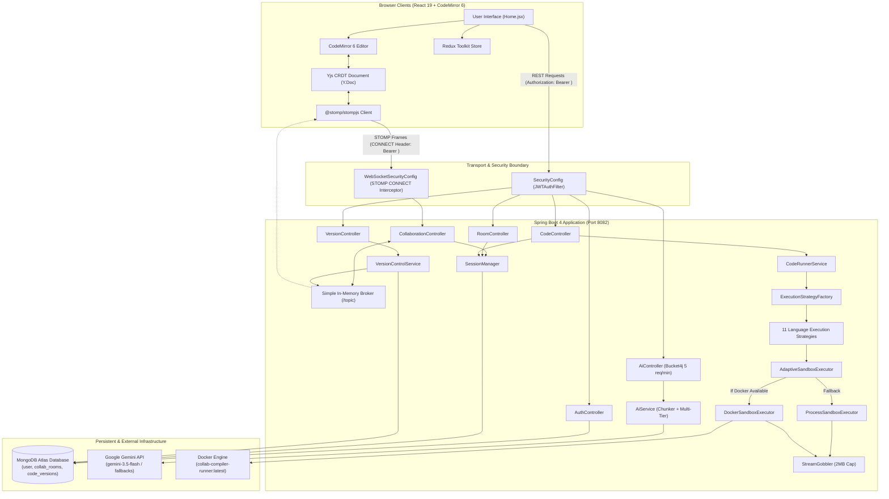
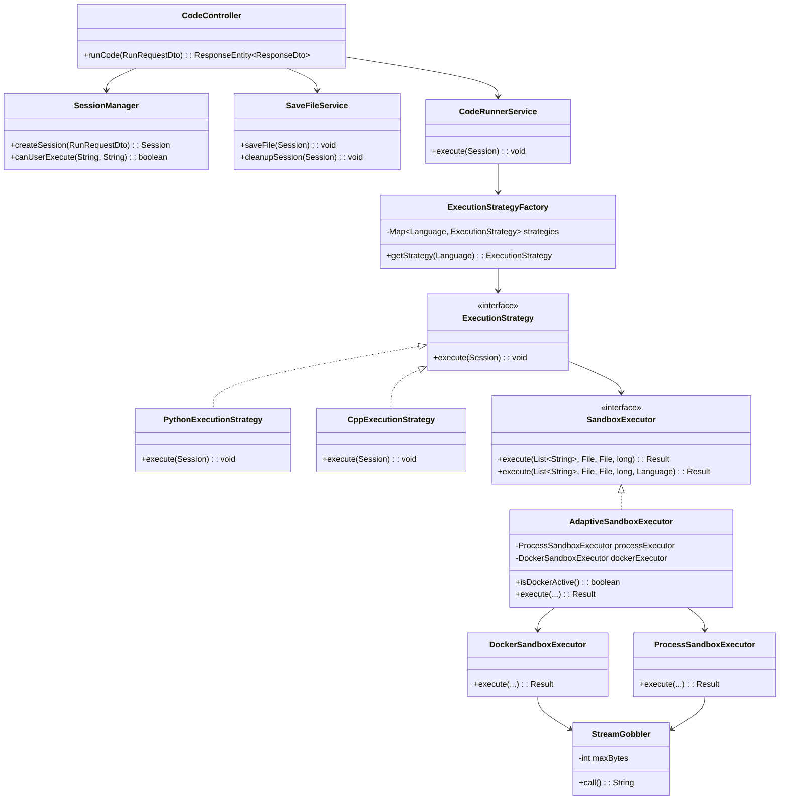
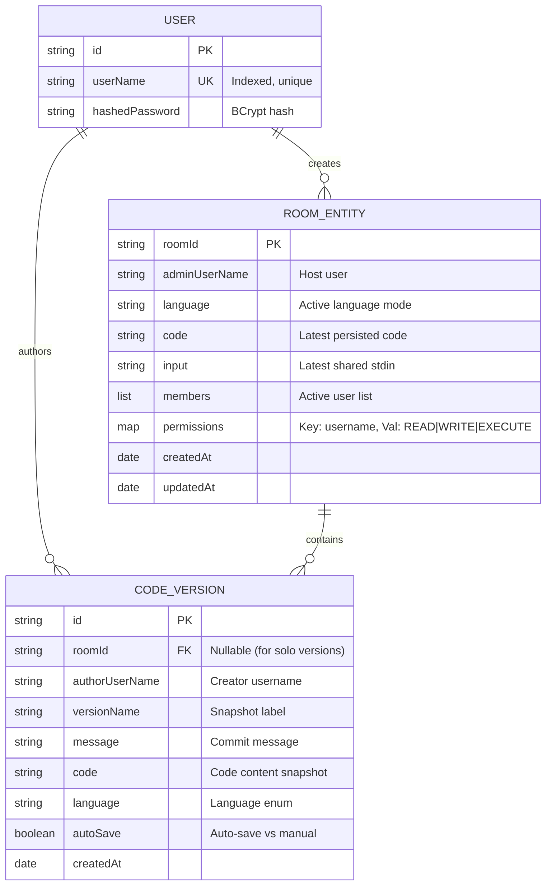
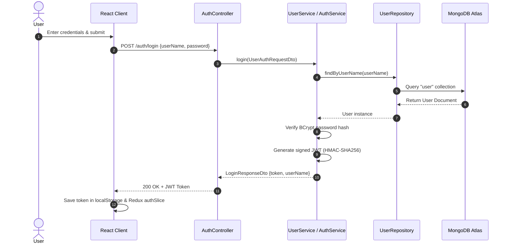
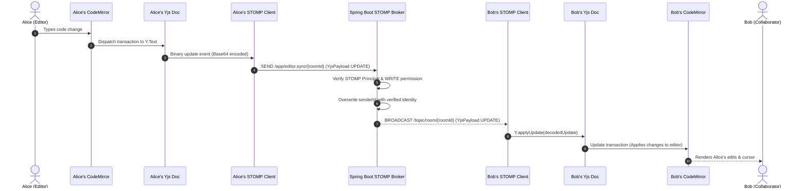
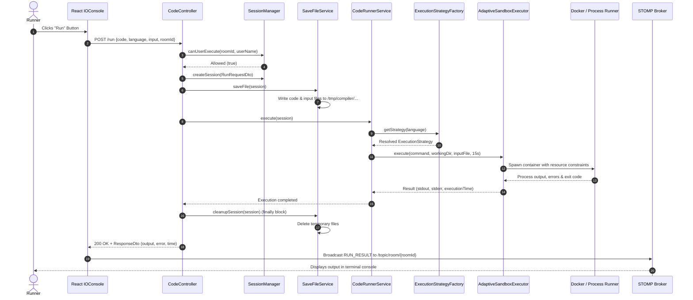
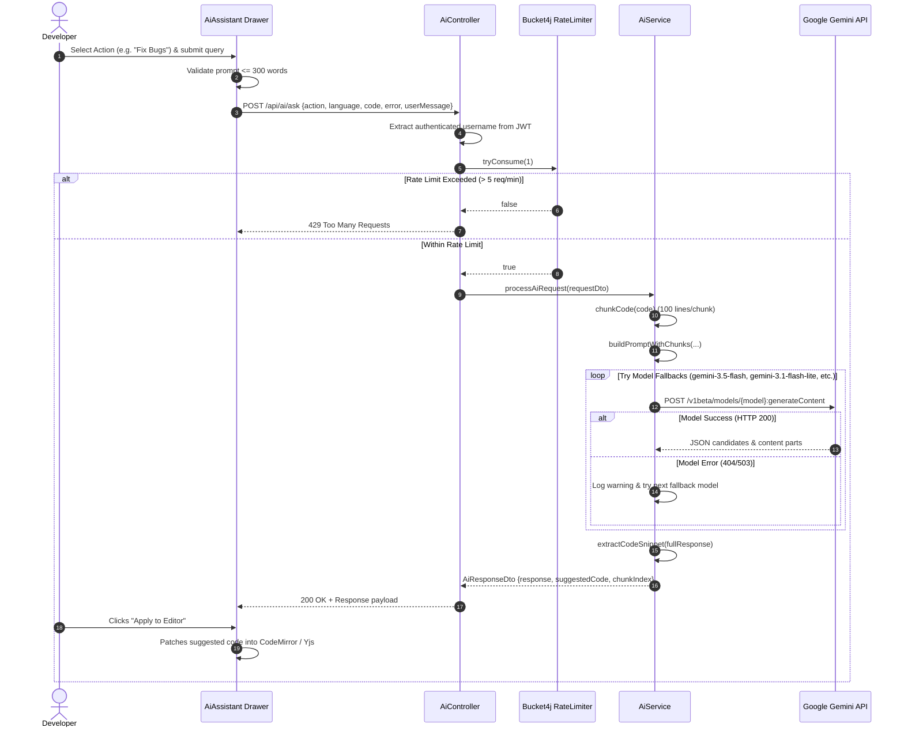
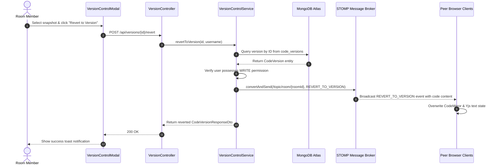

# ⚡ Collab Compiler: System Architecture & Technical Documentation

> **Comprehensive Technical Architecture, API Specification, and Developer Handbook**  
> *Target Audience: Software Engineers, Architects, DevOps, and Technical Contributors*

---

## 1. Project Overview

### 1.1 Project Name
**Collab Compiler** (also referenced as **CollabIDE**)

### 1.2 Description
Collab Compiler is an enterprise-grade, cloud-native **real-time collaborative code editor and multi-language execution engine**. It allows multiple developers to write, inspect, discuss, version-control, and execute code simultaneously inside an interactive, synchronized web environment without race conditions or merge conflicts.

### 1.3 Problem Statement & Core Value Proposition
- **The Problem:** Traditional code interview tools, online compilers, and educational IDEs either execute code in isolation (single-user), lack conflict-free collaborative editing, expose servers to remote code execution (RCE) vulnerabilities, or suffer from synchronization lag and merge collisions when multiple users edit concurrently.
- **The Solution:** Collab Compiler integrates **Conflict-Free Replicated Data Types (CRDTs via Yjs)** with a **STOMP-over-WebSocket protocol** and a **dual-mode adaptive sandbox execution engine (Docker containerization + unprivileged OS processes)**. It provides real-time multi-cursor collaboration, role-based access control (`Host`, `Runner`, `Editor`, `Viewer`), visual version control with snapshot diffing, and Google Gemini AI assistance with automated 100-line chunking and Bucket4j rate limiting.

### 1.4 Target Users
1. **Technical Interviewers & Candidates:** Conduct live coding interviews with synchronized standard input/output, execution privileges, and instant runtime diagnostics.
2. **Computer Science Students & Educators:** Deliver interactive programming lectures where professors demonstrate algorithms and students follow along in real-time.
3. **Distributed Engineering Teams:** Pair-program, debug tricky algorithms, and inspect execution output collaboratively across distributed timezones.
4. **Competitive Programmers:** Rapidly prototype and benchmark algorithmic solutions in 11 different languages with customized test-case inputs.

### 1.5 Key Features & Capabilities
- **Real-Time CRDT Synchronization:** Sub-50ms operational synchronization powered by Yjs and binary Base64 state vectors broadcast across Spring Boot STOMP topics.
- **Granular Room Permissions:** Dynamic role hierarchy:
  - `Host (👑)`: Full administrative control, member role promotion/demotion, and room destruction.
  - `Runner (🚀)`: Full collaborative editing (`WRITE`) and remote code execution (`EXECUTE`).
  - `Editor (✏️)`: Collaborative editing enabled; execution privileges withheld.
  - `Viewer (👁️)`: Read-only access with locked CodeMirror instances and real-time cursor tracking.
- **11-Language Execution Engine:** Multi-language support for Python, C++, C, Java, Go, JavaScript, TypeScript, Rust, PHP, Ruby, and Bash.
- **Adaptive Execution Sandboxing:** Dynamic environment detection executing untrusted code inside hardened, network-isolated Docker containers (`--network=none`, `--memory=256m`, `--pids-limit=64`), with graceful fallback to an asynchronous, capped process runner (`StreamGobbler` 2MB buffer cap and 15s watchdog).
- **Google Gemini AI Code Intelligence:** Integrated AI assistant drawer supporting `EXPLAIN`, `FIX`, `OPTIMIZE`, and `CHAT` actions with multi-tier model fallbacks (`gemini-3.5-flash`, `gemini-3.1-flash-lite`, etc.), 100-line code chunking, and 300-word prompt validation.
- **Visual Version Control & Room-Wide Revert:** Point-in-time code snapshotting, visual Longest Common Subsequence (LCS) diffing, 5-minute periodic auto-checkpoints, and 1-click room-wide code state rollbacks.
- **In-Room Chat & Presence:** Synchronized real-time chat with unread message badges, role indicators, and participant connection rosters.
- **File System Drag-and-Drop:** Instant file ingestion supporting drag-and-drop code loading with automatic file-extension syntax detection.

---

## 2. Complete Technology Stack

### 2.1 Frontend Architecture

| Category | Technology | Version | Purpose & Location |
| :--- | :--- | :--- | :--- |
| **Core Framework** | React | `^19.2.0` | Declarative UI rendering, hooks, and virtual DOM (`Compiler-frontend/src/`) |
| **Build Tool & Dev Server**| Vite | `^7.3.1` | Hot Module Replacement (HMR), ESM bundler (`vite.config.js`) |
| **Routing** | React Router DOM | `^7.13.2` | Client-side page navigation (`App.jsx`, `Home.jsx`, `Login.jsx`, `Signup.jsx`) |
| **Global State Management**| Redux Toolkit & React-Redux | `^2.11.2` / `^9.2.0` | Global state stores for auth tokens, code content, language, and user profile (`slices/`) |
| **Code Editor Engine** | CodeMirror 6 / `@uiw/react-codemirror` | `^4.25.9` | High-performance extensible code editor with syntax tree parsing (`components/editor/CodeEditor.jsx`) |
| **Language Extensions** | `@codemirror/lang-*` | `^6.0.0` - `^6.2.5`| Official syntax highlighting for Python, C++, Java, Go, JS, Rust, PHP |
| **CRDT Collaboration** | Yjs | `^13.6.30` | Conflict-Free Replicated Data Type framework ensuring convergence across clients |
| **Editor CRDT Binding** | `y-codemirror.next` | `^0.3.5` | Binds Yjs `Y.Text` structures directly to CodeMirror 6 transaction pipelines |
| **Binary Serialization** | `base64-js` | `^1.5.1` | Encodes/decodes binary CRDT update vectors for JSON-compatible STOMP payloads |
| **WebSocket Client** | `@stomp/stompjs` | `^7.3.0` | STOMP messaging client managing topic subscriptions and publications |
| **WebSocket Fallback** | `sockjs-client` | `^1.6.1` | Polyfill providing fallback HTTP streaming/polling when WebSockets are blocked |
| **HTTP Client** | Axios | `^1.14.0` | Intercepted REST HTTP requests to Spring Boot backend (`services/apiConnector.jsx`) |
| **Styling & Design System**| Tailwind CSS | `^4.2.2` | Utility-first CSS styling, custom design tokens, dark/light theme support (`index.css`) |
| **Toast Notifications** | React Hot Toast | `^2.6.0` | Non-blocking visual alerts for copy events, file loads, and execution errors |

---

### 2.2 Backend Architecture

| Category | Technology | Version | Purpose & Location |
| :--- | :--- | :--- | :--- |
| **Runtime Environment** | OpenJDK Java | `21` (LTS) | Virtual threads, modern switch pattern matching, and runtime execution |
| **Core Framework** | Spring Boot | `4.0.2` | Core backend framework, dependency injection, auto-configuration (`Compiler/pom.xml`) |
| **Web MVC** | `spring-boot-starter-webmvc` | `4.0.2` | RESTful API controllers, exception handling, and request mapping |
| **WebSocket & Messaging** | `spring-boot-starter-websocket`| `4.0.2` | Simple in-memory message broker, STOMP endpoint registration (`WebSocketConfig.java`) |
| **Security Framework** | `spring-boot-starter-security` | `4.0.2` | Stateless filter chains, BCrypt password hashing, and endpoint authorization |
| **JWT Library** | JJWT (`jjwt-api`, `impl`, `jackson`)| `0.12.6` | Stateless JWT generation, signing (HMAC-SHA256), and claims validation (`AuthUtil.java`) |
| **Rate Limiter** | Bucket4j (`bucket4j-core`) | `8.10.1` | In-memory token-bucket algorithm limiting AI endpoint abuse to 5 req/min (`AiController.java`) |
| **Boilerplate Reduction**| Project Lombok | Latest | Auto-generates getters, setters, builders, and SLF4J logging instances |
| **JSON Processor** | Jackson Databind | Latest | JSON serialization and deserialization for REST payloads and Gemini API calls |
| **Process Execution** | Java ProcessBuilder & Concurrency | Java 21 stdlib | Spawns sandboxed host processes and Docker container lifecycles |

---

### 2.3 Database & Persistence

| Category | Technology | Version / Spec | Purpose & Location |
| :--- | :--- | :--- | :--- |
| **Database Engine** | MongoDB Atlas / Local | Multi-model NoSQL | Document database storing user accounts, room entities, and code version snapshots |
| **Data Connector** | Spring Data MongoDB | `4.0.2` | Spring object-document mapping (ODM), repository abstractions, and index lifecycle |
| **Entity Collections** | `user`, `collab_rooms`, `code_versions` | BSON Documents | Data models for user auth, persistent room sessions, and version control snapshots |
| **In-Memory Store** | `InMemoryRoomSessionRepository` | ConcurrentHashMap | Zero-dependency high-throughput room session store for development |

---

### 2.4 Infrastructure, Sandboxing & DevOps

| Component | Technology | Specification / Configuration | Purpose |
| :--- | :--- | :--- | :--- |
| **Runner Container** | Docker | `debian:bookworm-slim` | Multi-language execution container with unprivileged user `runner:1001` (`runner/Dockerfile`) |
| **Backend Container**| Docker Multi-Stage | `eclipse-temurin:21-jdk-jammy` + `jre-jammy` | Multi-stage production build packaging JAR and 11 compiler runtimes (`Dockerfile`) |
| **Sandbox Hardening**| Docker CLI cgroups | `--network=none --memory=256m --pids-limit=64 --cpus=1.0 --rm` | Resource-constrained execution sandbox preventing SSRF, fork bombs, and OOM |
| **Stream Gobbler** | Asynchronous IO | Thread-pooled reader capped at 2MB | Drains OS stdout/stderr buffers to prevent pipe deadlocks and JVM heap exhaustion |
| **Startup Automation**| Batch & PowerShell Scripts | `start.bat`, `start.ps1`, `stop.bat`, `stop.ps1` | Orchestrates concurrent multi-service startup across Windows and POSIX environments |

---

## 3. Complete Folder and File Structure

```text
Collab Compiler/
├── .dockerignore                            # Ignores build artifacts and node_modules during Docker packaging
├── .gitignore                               # Git exclusions for IDE caches, class files, and secrets
├── Dockerfile                               # Multi-stage production Dockerfile for Spring Boot + 11 runtimes
├── README.md                                # High-level project summary and quickstart guide
├── PROJECT_DOCUMENTATION.md                 # Complete, comprehensive developer architecture documentation
├── start.bat                                # Windows Batch script launching backend & frontend in minimized windows
├── start.ps1                                # PowerShell script launching backend & frontend processes
├── start.sh                                 # POSIX shell script launching backend & frontend in background
├── stop.bat                                 # Windows Batch script terminating running port 8082 and 5173 tasks
├── stop.ps1                                 # PowerShell script terminating background processes
├── stop.sh                                  # POSIX shell script terminating background processes
│
├── runner/                                  # Sandboxed Execution Worker Image
│   ├── Dockerfile                           # Debian Bookworm runner image with compilers & unprivileged user
│   ├── build-runner-image.bat               # Windows 1-click script building collab-compiler-runner:latest
│   └── build-runner-image.sh                # Linux/macOS script building collab-compiler-runner:latest
│
├── Compiler/                                # Spring Boot 4 (Java 21) Backend Service
│   ├── mvnw / mvnw.cmd                      # Maven Wrapper executables
│   ├── pom.xml                              # Maven project descriptor, dependencies, and compiler plugins
│   ├── run-backend.bat                      # Dedicated backend execution batch runner
│   └── src/
│       ├── main/
│       │   ├── java/com/example/demo/
│       │   │   ├── CompilerProjectApplication.java # Spring Boot application main entry point
│       │   │   │
│       │   │   ├── common/                  # Standardized envelopes and global exceptions
│       │   │   │   ├── exception/
│       │   │   │   │   ├── GlobalExceptionHandler.java     # Translates domain exceptions into HTTP responses
│       │   │   │   │   ├── ExecutionException.java         # Thrown during compilation/runtime failures
│       │   │   │   │   ├── ResourceNotFoundException.java  # Thrown when rooms or entities are missing
│       │   │   │   │   └── UnauthorizedException.java      # Thrown on permission check violations
│       │   │   │   └── response/
│       │   │   │       └── ApiResponse.java                # Standard generic response wrapper
│       │   │   │
│       │   │   ├── config/                  # Configuration beans
│       │   │   │   ├── AppConfig.java                  # General application beans (BCryptPasswordEncoder)
│       │   │   │   ├── CorsConfig.java                 # WebMvcConfigurer CORS pattern mappings
│       │   │   │   ├── MongoConfig.java                # MongoDB connection and audit configurations
│       │   │   │   ├── SecurityConfig.java             # Spring Security filter chain, JWT filter binding
│       │   │   │   ├── WebSocketConfig.java            # STOMP broker registration (/ws-compiler, /topic, /app)
│       │   │   │   └── WebSocketSecurityConfig.java    # Intercepts STOMP CONNECT to enforce Bearer tokens
│       │   │   │
│       │   │   ├── controller/              # REST and STOMP message endpoints
│       │   │   │   ├── AiController.java               # POST /api/ai/ask with Bucket4j rate limiting
│       │   │   │   ├── AuthController.java             # POST /auth/signup, POST /auth/login
│       │   │   │   ├── CodeController.java             # POST /run (code execution orchestrator)
│       │   │   │   ├── CollaborationController.java    # @MessageMapping /editor.sync/{roomId}
│       │   │   │   ├── RoomController.java             # Room creation, joining, and permission updates
│       │   │   │   └── VersionController.java          # Version snapshots, history, and revert operations
│       │   │   │
│       │   │   ├── dto/                         # Data Transfer Objects
│       │   │   │   ├── AiRequestDto.java               # AI assistant query parameters and chunk coordinates
│       │   │   │   ├── AiResponseDto.java              # Structured Gemini response with extracted snippets
│       │   │   │   ├── CodeVersionResponseDto.java     # Version metadata and code content response
│       │   │   │   ├── CollaborationDto.java           # Room initialization parameters
│       │   │   │   ├── CreateSessionResponseDto.java   # Room creation confirmation response
│       │   │   │   ├── CreateUserResponseDto.java      # Account registration response
│       │   │   │   ├── CreateVersionRequestDto.java    # Commit snapshot request payload
│       │   │   │   ├── JoinRoomDto.java                # Room join request credentials
│       │   │   │   ├── LoginResponseDto.java           # Auth token and profile response
│       │   │   │   ├── ResponseDto.java                # Code execution result (stdout, stderr, exit code)
│       │   │   │   ├── RoomDetailsDto.java             # Detailed room metadata, host, and member roster
│       │   │   │   ├── RoomMemberDto.java              # Member permission details
│       │   │   │   ├── RunRequestDto.java              # Code execution request payload
│       │   │   │   ├── UpdatePermissionDto.java        # Administrative role modification payload
│       │   │   │   ├── UserAuthRequestDto.java         # Signup and login credentials
│       │   │   │   └── YjsPayload.java                 # Generic STOMP collaborative broadcast envelope
│       │   │   │
│       │   │   ├── entity/types/                # Domain models and enumerated types
│       │   │   │   ├── CodeVersion.java                # MongoDB document for code snapshot commits
│       │   │   │   ├── Language.java                   # Enum of 11 supported compilation languages
│       │   │   │   ├── RoomEntity.java                 # MongoDB document persisting room state
│       │   │   │   ├── RoomPermission.java             # Enum: READ, WRITE, EXECUTE
│       │   │   │   ├── Session.java                    # Ephemeral code execution session model
│       │   │   │   └── User.java                       # MongoDB document implementing UserDetails
│       │   │   │
│       │   │   ├── manager/
│       │   │   │   └── SessionManager.java             # Central state coordinator for rooms, members & permissions
│       │   │   │
│       │   │   ├── modules/
│       │   │   │   ├── room/repository/                # Room persistence strategies
│       │   │   │   │   ├── RoomSessionRepository.java          # Room store contract
│       │   │   │   │   ├── MongoRoomSessionRepository.java     # Persistent MongoDB room store (@Primary)
│       │   │   │   │   └── InMemoryRoomSessionRepository.java  # High-throughput ConcurrentHashMap store
│       │   │   │   │
│       │   │   │   └── runner/
│       │   │   │       ├── sandbox/                    # Sandboxed process execution engine
│       │   │   │       │   ├── SandboxExecutor.java            # Common execution abstraction interface
│       │   │   │       │   ├── AdaptiveSandboxExecutor.java    # @Primary dispatcher (Docker vs Host fallback)
│       │   │   │       │   ├── DockerSandboxExecutor.java      # Containerized isolation executor
│       │   │   │       │   ├── ProcessSandboxExecutor.java     # Host process executor with thread pools
│       │   │   │       │   └── StreamGobbler.java              # Asynchronous pipe drainer with 2MB cap
│       │   │   │       │
│       │   │   │       └── strategy/                   # Language execution strategy pattern
│       │   │   │           ├── ExecutionStrategy.java          # Strategy interface for compiling and running
│       │   │   │           ├── ExecutionStrategyFactory.java   # Dynamic Spring bean resolver for strategies
│       │   │   │           ├── PythonExecutionStrategy.java    # Python 3 execution handler
│       │   │   │           ├── CppExecutionStrategy.java       # GCC G++ compilation and binary execution
│       │   │   │           ├── CExecutionStrategy.java         # GCC C compilation handler
│       │   │   │           ├── JavaExecutionStrategy.java      # Javac compilation and JVM runtime handler
│       │   │   │           ├── GoExecutionStrategy.java        # Golang runner handler
│       │   │   │           ├── JsExecutionStrategy.java        # Node.js execution handler
│       │   │   │           ├── TypeScriptExecutionStrategy.java# Node.js + tsx TypeScript handler
│       │   │   │           ├── RustExecutionStrategy.java      # Rustc compilation and binary handler
│       │   │   │           ├── PhpExecutionStrategy.java       # PHP CLI execution handler
│       │   │   │           ├── RubyExecutionStrategy.java      # Ruby execution handler
│       │   │   │           └── BashExecutionStrategy.java      # GNU Bash execution handler
│       │   │   │
│       │   │   ├── repositories/                # Spring Data MongoDB Repository Interfaces
│       │   │   │   ├── CodeVersionRepository.java      # CRUD queries for code_versions collection
│       │   │   │   ├── RoomEntityRepository.java       # CRUD queries for collab_rooms collection
│       │   │   │   └── UserRepository.java             # Queries for user collection (findByUserName)
│       │   │   │
│       │   │   ├── security/
│       │   │   │   └── JWTAuthFilter.java              # Per-request HTTP filter validating Bearer tokens
│       │   │   │
│       │   │   ├── service/                     # Core Business Services
│       │   │   │   ├── AiService.java                  # Gemini API integration, chunking, and fallbacks
│       │   │   │   ├── AuthService.java                # Authentication logic, password verification
│       │   │   │   ├── CodeRunnerService.java          # Executes code via StrategyFactory & SandboxExecutor
│       │   │   │   ├── CustomUserDetailsService.java   # Loads UserDetails for Spring Security
│       │   │   │   ├── SaveFileService.java            # Manages temporary source files and workspace cleanup
│       │   │   │   ├── UserService.java                # User registration and duplicate check service
│       │   │   │   └── VersionControlService.java      # Snapshot saving, history listing, and revert broadcasting
│       │   │   │
│       │   │   └── utils/
│       │   │       ├── AuthUtil.java                   # Cryptographic signing and token parsing
│       │   │       └── Commands.java                   # Predefined platform command templates
│       │   │
│       │   └── resources/
│       │       ├── application.properties          # Active Spring Boot configuration
│       │       └── application.properties.example  # Template configuration for environment setup
│       │
│       └── test/java/com/example/demo/
│           ├── CompilerProjectApplicationTests.java # Context loading integration test suite
│           └── DemoApplicationTests.java            # Spring boot smoke tests
│
└── Compiler-frontend/                       # React 19 + Vite Frontend Application
    ├── package.json                         # Node dependencies, scripts, and build metadata
    ├── vite.config.js                       # Vite bundler configuration with Tailwind integration
    ├── run-frontend.bat                     # Dedicated frontend execution batch runner
    ├── .env                                 # Environment file (VITE_BACKEND_URL)
    ├── public/                              # Static public assets
    └── src/
        ├── App.jsx                          # Main routing tree and global Toast container
        ├── main.jsx                         # React root bootstrap, Redux Provider, BrowserRouter
        ├── index.css                        # CSS design tokens, scrollbars, and dark/light variables
        │
        ├── assets/                          # Images, SVG icons, and media files
        │   ├── chatbox.png
        │   └── react.svg
        │
        ├── components/                      # Modular UI component tree
        │   ├── ai/
        │   │   └── AiAssistant.jsx          # Drawer for Gemini AI explanations, bugs, and optimization
        │   ├── chat/
        │   │   └── ChatBox.jsx              # Floating room chat modal with unread counter
        │   ├── common/
        │   │   └── Navbar.jsx               # Header bar with language picker, Run, and file open
        │   ├── editor/
        │   │   ├── CodeEditor.jsx           # CodeMirror 6 instance bound to Yjs CRDT extensions
        │   │   └── IOConsole.jsx            # Split custom standard input and execution output terminal
        │   └── room/
        │       ├── CollabBar.jsx            # Collaboration control bar (Join, Create, Disconnect, Roles)
        │       ├── CollaboratorsModal.jsx   # Administrative participant management dialog
        │       └── VersionControlModal.jsx  # Version snapshot timeline, LCS diff viewer, and rollback
        │
        ├── context/
        │   └── ThemeContext.jsx             # React context provider for light and dark theme toggling
        │
        ├── hooks/                           # Custom Business Logic Hooks
        │   ├── useChat.js                   # Handles chat state, unread badges, and message routing
        │   ├── useCollaboration.js          # Encapsulates Yjs document, STOMP subscriptions, and sync
        │   └── useFileImport.js             # Encapsulates drag-and-drop file ingestion and extension detection
        │
        ├── pages/                           # Application Route Views
        │   ├── Home.jsx                     # Primary workspace page orchestrating editor, console, and modals
        │   ├── Login.jsx                    # User authentication login view
        │   └── Signup.jsx                   # User account registration view
        │
        ├── reducers/
        │   └── index.jsx                    # Combines auth, code, and profile reducers for Redux store
        │
        ├── services/                        # HTTP and API Networking Layer
        │   ├── apiConnector.jsx             # Axios instance wrapper with centralized error handling
        │   ├── apis.jsx                     # Centralized API endpoint URL constants
        │   └── operations/
        │       ├── authApi.jsx              # Redux async thunks for login, signup, and logout
        │       └── codeApi.jsx              # API calls for code execution
        │
        ├── slices/                          # Redux Toolkit State Slices
        │   ├── authSlice.jsx                # Tracks JWT token state and authentication status
        │   ├── codeSlice.jsx                # Tracks code content, selected language, input, and output
        │   └── profileSlice.jsx             # Tracks current user profile data
        │
        └── utils/                           # Client Helpers and Algorithms
            ├── diffUtils.js                 # Longest Common Subsequence (LCS) line-by-line diff calculator
            └── languageExtension.js         # Resolves file extensions to language enums
```

---

## 4. System Architecture

### 4.1 High-Level Architecture Diagram
The architecture is structured as a decoupled client-server system communicating over two distinct communication channels:
1. **Stateless HTTP/REST (Port 8082):** For authentication, room management, code execution submission, version history, and AI assistance.
2. **Stateful STOMP-over-WebSocket (Port 8082, `/ws-compiler`):** For sub-50ms peer-to-peer Yjs CRDT synchronization, shared input changes, run result broadcasts, and room chat.



---

### 4.2 Request-Response Lifecycle
1. **Authentication:** The client submits credentials to `/auth/login`. The server verifies the BCrypt hash against MongoDB and returns a signed HMAC-SHA256 JWT.
2. **Room Entry:** The client requests room membership via `POST /collab/join`. Upon verification, the client opens a WebSocket connection to `/ws-compiler` and sends a STOMP `CONNECT` frame containing `Authorization: Bearer <token>`.
3. **STOMP Inbound Security:** `WebSocketSecurityConfig` intercepts the `CONNECT` frame, extracts and validates the token, queries the user repository, and binds an authenticated `UsernamePasswordAuthenticationToken` to the WebSocket session headers.
4. **Synchronization:**
   - The client subscribes to `/topic/room/{roomId}`.
   - When a user types, `y-codemirror.next` generates a binary CRDT update.
   - The client Base64-encodes the update and publishes it to `/app/editor.sync/{roomId}`.
   - `CollaborationController` inspects the sender's verified principal. If the sender possesses `READ` (view-only) permissions, the update is dropped. Otherwise, it is broadcast to all room subscribers.
5. **Execution:**
   - The user clicks **Run**. The client invokes `POST /run`.
   - `CodeController` verifies the user holds `EXECUTE` privileges.
   - `SaveFileService` writes the source code and input data into a temporary directory (`/tmp/compiler/<user>_<session>/`).
   - `CodeRunnerService` resolves the appropriate `ExecutionStrategy` (e.g. `CppExecutionStrategy`), which commands `AdaptiveSandboxExecutor`.
   - `AdaptiveSandboxExecutor` checks Docker daemon responsiveness. If Docker is active, it runs the code in `collab-compiler-runner:latest` with `--network=none --memory=256m --pids-limit=64`. If not, it falls back to `ProcessSandboxExecutor`.
   - `StreamGobbler` reads the process streams asynchronously, capping output at 2MB.
   - The execution response (stdout, stderr, elapsed time) is returned to the runner and broadcast to room peers via STOMP `RUN_RESULT`.
   - Temporary files are purged in a `finally` block.

---

## 5. Frontend Documentation

### 5.1 Application Entry & Routing
- **Entry File:** [`Compiler-frontend/src/main.jsx`](file:///d:/Collab%20Compiler/Compiler-frontend/src/main.jsx)
  - Wraps the DOM in `Provider` (Redux), `BrowserRouter`, and `ThemeProvider`.
- **Router Configuration:** [`Compiler-frontend/src/App.jsx`](file:///d:/Collab%20Compiler/Compiler-frontend/src/App.jsx)
  - `/` &rarr; `<Home />` (Main collaborative workspace)
  - `/login` &rarr; `<Login />` (User authentication)
  - `/signup` &rarr; `<Signup />` (New account creation)
  - Global `<Toaster />` configured for notifications with high z-index (`9999`).

### 5.2 State Management Architecture
The frontend utilizes a hybrid state management model:
1. **Redux Toolkit (`src/slices/`):**
   - `authSlice.jsx`: Stores `token` (initialized from `localStorage.getItem("token")`).
   - `codeSlice.jsx`: Tracks `code`, active `language` (e.g. "PYTHON"), standard `input`, and execution `output`.
   - `profileSlice.jsx`: Stores the authenticated `user` profile.
2. **Yjs CRDT Document (`useCollaboration.js`):**
   - Maintains the single source of truth for shared text in collaborative rooms.
   - Handles operational transformations automatically to prevent race conditions.
3. **Local Component State (`useState` & `useRef`):**
   - Manages UI drawer visibility (`aiAssistantOpen`, `versionControlOpen`, `chatBoxVisible`), draggable splitter ratios (`editorWidth`, `inputHeight`), and unread chat counts.

### 5.3 Key Components

#### 5.3.1 `Home.jsx` (Workspace Orchestrator)
- **Props:** None (Route view).
- **Responsibilities:**
  - Manages dual-pane responsive layout with draggable splitters.
  - Detects screen sizes: provides unified side-by-side view on desktop (`>= 1024px`) and tabbed view (`Code Editor` vs `Terminal & Output`) on mobile/tablet.
  - Binds the 5-minute periodic auto-save checkpoint timer.
  - Coordinates file drag-and-drop overlays.

#### 5.3.2 `CodeEditor.jsx` (CodeMirror 6 Container)
- **Props:**
  - `language`: Current programming language enum string.
  - `extensions`: Array of CodeMirror extensions (syntax highlighter + `yCollabExtension`).
  - `onChange`: Change callback for solo editing mode.
  - `isCollaborating`: Boolean flag indicating room state.
  - `myPermission`: Access level (`READ`, `WRITE`, `EXECUTE`).
- **Features:**
  - Renders a read-only lock banner when `myPermission === 'READ'`, preventing keystrokes.
  - Uses `@uiw/react-codemirror` configured with `oneDark` theme, line numbers, and bracket matching.

#### 5.3.3 `IOConsole.jsx` (Input / Output Terminal)
- **Props:**
  - `input`: Standard input string bound to the custom input textarea.
  - `output`: Output string received from execution runs.
  - `onInputChange`: Callback propagating stdin modifications to peers.
  - `isCollaborating`: Boolean flag.
  - `myPermission`: Current user permission level.
- **Features:**
  - Resizable vertical split between input and output with draggable grip divider (15% to 85% range).
  - Formats ANSI error outputs and displays execution time metrics.

#### 5.3.4 `CollabBar.jsx` & `CollaboratorsModal.jsx` (Room Administration)
- **Responsibilities:**
  - Surfaces active room ID, role badges (`👑 Host`, `🚀 Runner`, `✏️ Editor`, `👁️ Viewer`), and participant counts.
  - Provides quick action triggers: **Create Room**, **Join Room**, **Disconnect**, **Version Control**, and **AI Assistant**.
  - `CollaboratorsModal.jsx` allows the room creator to modify member permissions dynamically via `POST /collab/permission`.

#### 5.3.5 `VersionControlModal.jsx` & `diffUtils.js` (Snapshot & Diff Engine)
- **Responsibilities:**
  - Displays a visual timeline of all code snapshots for the room or solo workspace.
  - Allows manual snapshot creation with custom names and commit messages.
  - Calculates line-by-line differences using the Longest Common Subsequence (LCS) algorithm implemented in `diffUtils.js`.
  - Color-codes diffs (`green` additions, `red` deletions, `neutral` unchanged lines).
  - Triggers 1-click rollbacks: in collaborative rooms, broadcasts `REVERT_TO_VERSION` to roll back the editor on all connected peers simultaneously.

#### 5.3.6 `AiAssistant.jsx` (Gemini Intelligence Drawer)
- **Responsibilities:**
  - Slide-out drawer with dedicated action buttons: **💡 Explain Code**, **🐞 Fix Bugs & Errors**, **⚡ Optimize $O(N)$**, and **💬 Ask AI**.
  - Implements client-side word count tracking (flags prompts exceeding 300 words).
  - Surfaces 100-line chunk badges when code exceeds 100 lines, enabling users to target specific code blocks.
  - Provides a 1-click **Apply to Editor** button that patches the generated solution directly into CodeMirror.

---

### 5.4 Custom Hooks

#### 5.4.1 `useCollaboration.js`
- **Location:** [`Compiler-frontend/src/hooks/useCollaboration.js`](file:///d:/Collab%20Compiler/Compiler-frontend/src/hooks/useCollaboration.js)
- **Responsibilities:**
  - Instantiates the `Y.Doc` and `Y.Text` instances.
  - Connects to the STOMP broker via `@stomp/stompjs` and `sockjs-client`.
  - Sets the STOMP `CONNECT` header: `{ Authorization: 'Bearer ' + token }`.
  - Binds CodeMirror to Yjs using `yCollab(ytext, provider.awareness)`.
  - Encodes local Yjs binary updates to Base64 and publishes to `/app/editor.sync/{roomId}`.
  - Subscribes to `/topic/room/{roomId}` and handles inbound message types:
    - `SYNC_REQUEST` & `SYNC_STATE`: Synchronizes new peers with the current document state.
    - `UPDATE`: Applies binary CRDT delta to the local `Y.Doc`.
    - `INPUT_CHANGE`: Synchronizes standard input across terminals.
    - `RUN_RESULT`: Displays shared execution output in the console.
    - `PERMISSION_CHANGE`: Updates local user privileges in real-time.
    - `REVERT_TO_VERSION`: Replaces editor content when a rollback is triggered.

#### 5.4.2 `useChat.js`
- **Location:** [`Compiler-frontend/src/hooks/useChat.js`](file:///d:/Collab%20Compiler/Compiler-frontend/src/hooks/useChat.js)
- **Responsibilities:**
  - Tracks in-room message history (`senderId`, `content`, `timestamp`).
  - Maintains unread badge count when the chat drawer is closed.
  - Emits chat payloads to the room topic.

#### 5.4.3 `useFileImport.js`
- **Location:** [`Compiler-frontend/src/hooks/useFileImport.js`](file:///d:/Collab%20Compiler/Compiler-frontend/src/hooks/useFileImport.js)
- **Responsibilities:**
  - Manages drag-and-drop events (`dragover`, `dragleave`, `drop`) on the editor surface.
  - Inspects file extensions using `languageExtension.js` (`.py` &rarr; `PYTHON`, `.cpp` &rarr; `CPP`, etc.).
  - Reads file text via `FileReader` and triggers appropriate Redux or Yjs updates.

---

## 6. Backend Documentation

### 6.1 Server Initialization & Entry Point
- **Main Class:** [`Compiler/src/main/java/com/example/demo/CompilerProjectApplication.java`](file:///d:/Collab%20Compiler/Compiler/src/main/java/com/example/demo/CompilerProjectApplication.java)
- **Execution:** Bootstraps Spring ApplicationContext, initializes MongoDB auto-index creation, registers WebSocket handlers, and mounts REST endpoints.

### 6.2 Security Filter Execution Chain

```text
Inbound HTTP Request
       │
       ▼
[CorsFilter] ─── Verifies Origin pattern (localhost, *.vercel.app, *.satyamvatsal.ovh)
       │
       ▼
[CSRF Filter] ── Disabled (Stateless API design)
       │
       ▼
[SessionManagement] ── STATELESS (No HTTP Session cookies created)
       │
       ▼
[JWTAuthFilter] ── Extracts "Authorization: Bearer <token>"
       │           ├─ If valid: Populates SecurityContextHolder with UserDetails
       │           └─ If invalid/missing: Proceeds as anonymous
       │
       ▼
[AuthorizationFilter] ── Checks Endpoint Security Rules:
       │                 ├─ /auth/**         ── permitAll()
       │                 ├─ /collab/**       ── permitAll()
       │                 ├─ /ws-compiler/**  ── permitAll() (SockJS handshake)
       │                 ├─ /api/ai/**       ── authenticated() (Requires JWT)
       │                 └─ anyRequest()     ── permitAll()
       │
       ▼
[Target Controller] (e.g. CodeController, AiController, VersionController)
```

---

### 6.3 Code Execution Engine (Low-Level Design)

The execution engine uses a combination of the **Strategy Pattern**, **Factory Pattern**, and **Adaptive Sandbox Pattern**:



#### Strategy Implementation Details
- **Open/Closed Principle (OCP):** To add a new programming language, create a new class implementing `ExecutionStrategy` annotated with `@Component`. Spring automatically injects it into `ExecutionStrategyFactory` without altering existing runners.
- **Language Compilation vs Interpretation:**
  - *Interpreted (Python, JS, PHP, Ruby, Bash):* The strategy generates a direct execution command (e.g., `python3 main.py`).
  - *Compiled (C++, C, Java, Go, Rust, TypeScript):* The strategy compiles the source file into an intermediate binary or bytecode before execution (e.g., `g++ main.cpp -O2 -o main.out && ./main.out`).
- **Resource Protection:**
  - Execution runs with a 15-second wall-clock timeout (`compiler.sandbox.timeout-seconds=15`).
  - Processes exceeding this limit are terminated forcibly with `process.destroyForcibly()`.
  - `StreamGobbler` drains output streams asynchronously into a bounded 2MB buffer, preventing OS pipe deadlocks and JVM Out-Of-Memory exceptions.

---

## 7. API Documentation

### 7.1 Complete REST Endpoints Table

| Method | Endpoint | Purpose | Auth | Path/Query Params | Request Body | Success Response | Error Responses | Source File |
| :--- | :--- | :--- | :--- | :--- | :--- | :--- | :--- | :--- | :--- |
| `POST` | `/auth/signup` | Register new user account | None | None | `{"userName": "alice", "password": "secret"}` | `200 OK` + `CreateUserResponseDto` | `400 Bad Request` (user exists) | `AuthController.java` |
| `POST` | `/auth/login` | Authenticate user & get JWT | None | None | `{"userName": "alice", "password": "secret"}` | `200 OK` + `LoginResponseDto` (token) | `401 Unauthorized` (bad credentials) | `AuthController.java` |
| `POST` | `/collab/info` | Create new collaborative room | None* | None | `{"userName": "alice", "code": "...", "language": "PYTHON", "input": ""}` | `201 Created` + `CreateSessionResponseDto` | `500 Internal Error` | `RoomController.java` |
| `POST` | `/collab/join` | Join existing collaborative room | None* | None | `{"roomId": "abcd-1234", "userName": "bob"}` | `200 OK` + `CreateSessionResponseDto` | `404 Not Found` (room absent) | `RoomController.java` |
| `GET` | `/collab/room/{roomId}` | Get room details & permissions | None | `roomId` (path), `user` (query) | None | `200 OK` + `RoomDetailsDto` | `404 Not Found` | `RoomController.java` |
| `POST` | `/collab/permission` | Update member permission | Host Only | None | `{"roomId": "...", "adminUserName": "alice", "targetUserName": "bob", "permission": "READ"}` | `200 OK` + JSON confirmation | `403 Forbidden` (non-admin) | `RoomController.java` |
| `POST` | `/run` | Compile & execute source code | Optional | None | `{"userName": "alice", "code": "print(1)", "language": "PYTHON", "input": "", "roomId": "..."}` | `200 OK` + `ResponseDto` (output, error, time) | `403 Forbidden` (no execute perm) | `CodeController.java` |
| `POST` | `/api/ai/ask` | Query Gemini AI code assistant | JWT Req | None | `{"action": "EXPLAIN", "language": "PYTHON", "code": "...", "error": "", "userMessage": ""}` | `200 OK` + `AiResponseDto` | `401 Unauthorized`, `429 Too Many Requests` | `AiController.java` |
| `POST` | `/api/versions` | Save code snapshot commit | Optional | None | `{"roomId": "...", "versionName": "V1", "message": "Initial", "code": "...", "language": "JAVA"}` | `200 OK` + `CodeVersionResponseDto` | `500 Internal Error` | `VersionController.java` |
| `GET` | `/api/versions` | List version history for room/user | Optional | `roomId` (query), `language` (query) | None | `200 OK` + `List<CodeVersionResponseDto>`| `200 OK` (empty list) | `VersionController.java` |
| `GET` | `/api/versions/{id}` | Get single version by ID | Optional | `id` (path) | None | `200 OK` + `CodeVersionResponseDto` | `404 Not Found` | `VersionController.java` |
| `POST` | `/api/versions/{id}/revert` | Rollback room/editor to snapshot | Optional | `id` (path) | None | `200 OK` + `CodeVersionResponseDto` | `403 Forbidden`, `404 Not Found` | `VersionController.java` |

*\*Note: Frontend routes enforce authentication before room creation or joining.*

---

### 7.2 Sample Requests and Responses

#### Code Execution (`POST /run`)
**Request:**
```json
{
  "userName": "alice",
  "code": "#include <iostream>\nint main() { std::cout << \"Hello from Collab Compiler!\"; return 0; }",
  "language": "CPP",
  "input": "",
  "roomId": "collab-room-992"
}
```
**Response (`200 OK`):**
```json
{
  "output": "Hello from Collab Compiler!",
  "error": "",
  "errorCode": 0,
  "timeTaken": 0.428
}
```

#### AI Assistance (`POST /api/ai/ask`)
**Request:**
```json
{
  "action": "FIX",
  "language": "PYTHON",
  "code": "def divide(a, b):\n    return a / b\nprint(divide(10, 0))",
  "error": "ZeroDivisionError: division by zero",
  "userMessage": "How do I fix this zero division bug?"
}
```
**Response (`200 OK`):**
```json
{
  "success": true,
  "response": "### 🐞 Bug Analysis\n1. **ZeroDivisionError**: The function attempts to divide by zero when `b == 0`.\n2. **Fix**: Add a guard condition checking if `b == 0` before division.\n\n```python\ndef divide(a, b):\n    if b == 0:\n        return 'Error: Division by zero is undefined'\n    return a / b\n\nprint(divide(10, 0))\n```",
  "suggestedCode": "def divide(a, b):\n    if b == 0:\n        return 'Error: Division by zero is undefined'\n    return a / b\n\nprint(divide(10, 0))",
  "chunkIndex": null,
  "totalChunks": 1,
  "promptWordCount": 7,
  "error": null
}
```

---

### 7.3 WebSocket STOMP Protocol Specification

- **Broker Handshake URL:** `ws://localhost:8082/ws-compiler` (or `https://.../ws-compiler` via SockJS)
- **Application Destination Prefix:** `/app`
- **Broker Topic Prefix:** `/topic`

#### Client-to-Server Destination: `/app/editor.sync/{roomId}`
Clients send real-time changes using the `YjsPayload` structure:
```json
{
  "senderId": "alice",
  "type": "UPDATE",
  "content": "AQD+v...",
  "timestamp": "2026-11-23T19:45:00Z"
}
```

#### Supported Event Types (`YjsPayload.type`)

| Event Type | Payload Content | Purpose |
| :--- | :--- | :--- |
| `SYNC_REQUEST` | Empty or client ID | Newly joined peer requesting current full room state |
| `SYNC_STATE` | Base64-encoded Yjs state vector | Existing peer providing authoritative room snapshot |
| `UPDATE` | Base64-encoded Yjs binary update | Incremental typing change emitted by an authorized editor |
| `INPUT_CHANGE` | Raw text string | Synchronizes the custom standard input textarea across all participants |
| `RUN_RESULT` | JSON string `{output, error, input}` | Broadcasts execution results simultaneously to all room participants |
| `LANGUAGE_CHANGE`| Language string (`CPP`, `PYTHON`) | Broadcasts language mode change to update syntax highlighting |
| `PERMISSION_CHANGE`| JSON `{targetUser, permission}` | Broadcasts administrative permission changes |
| `CHAT` | Plain text message | In-room messaging payload |
| `VERSION_CREATED` | String `{versionId}:{versionName}` | Informs peers of a new snapshot commit |
| `REVERT_TO_VERSION`| Source code content | Instructs all room clients to overwrite editor content with snapshot |

---

## 8. Database Documentation

### 8.1 MongoDB Collections & Schemas



### 8.2 Schema Definitions

#### 1. Collection: `user`
- **Class:** [`com.example.demo.entity.types.User`](file:///d:/Collab%20Compiler/Compiler/src/main/java/com/example/demo/entity/types/User.java)
- **Fields:**
  - `id`: `String` (MongoDB ObjectId, Primary Key)
  - `userName`: `String` (`@Indexed(unique = true)`, non-null)
  - `hashedPassword`: `String` (BCrypt encoded string)
- **Indexes:** Unique index on `userName`.

#### 2. Collection: `collab_rooms`
- **Class:** [`com.example.demo.entity.types.RoomEntity`](file:///d:/Collab%20Compiler/Compiler/src/main/java/com/example/demo/entity/types/RoomEntity.java)
- **Fields:**
  - `roomId`: `String` (`@Id`, Primary Key)
  - `adminUserName`: `String` (`@Indexed`, designated Host)
  - `language`: `String` (e.g., "PYTHON", "CPP")
  - `code`: `String` (Persisted code state)
  - `input`: `String` (Shared standard input)
  - `members`: `List<String>` (List of usernames currently in room)
  - `permissions`: `Map<String, RoomPermission>` (Map of username to `READ`, `WRITE`, or `EXECUTE`)
  - `createdAt`: `Instant` (Timestamp)
  - `updatedAt`: `Instant` (Timestamp)
- **Indexes:** Index on `adminUserName`.

#### 3. Collection: `code_versions`
- **Class:** [`com.example.demo.entity.types.CodeVersion`](file:///d:/Collab%20Compiler/Compiler/src/main/java/com/example/demo/entity/types/CodeVersion.java)
- **Fields:**
  - `id`: `String` (`@Id`, Primary Key)
  - `roomId`: `String` (`@Indexed`, null for solo snapshots)
  - `authorUserName`: `String` (`@Indexed`, username of creator)
  - `versionName`: `String` (e.g., "Checkpoint before refactor")
  - `message`: `String` (Optional commit description)
  - `code`: `String` (Full source code snapshot)
  - `language`: `String` (Language of snapshot)
  - `autoSave`: `boolean` (`true` if triggered by 5-min auto-save timer)
  - `createdAt`: `Instant` (Timestamp of snapshot)
- **Indexes:** Indexes on `roomId` and `authorUserName`.

---

## 9. Authentication and Security

### 9.1 Authentication Architecture
- **Stateless JWT Tokens:** Authentication relies entirely on stateless JSON Web Tokens signed using HMAC-SHA256 (`io.jsonwebtoken:jjwt-api:0.12.6`).
- **Token Claims:** Include subject (`username`), issued-at (`iat`), and expiration (`exp`) timestamps.
- **Password Storage:** User passwords are encrypted using Spring Security's `BCryptPasswordEncoder` with standard salt rounds before storage in MongoDB.

### 9.2 Dual-Layer Security Boundary

#### Layer 1: HTTP Filter Chain (`JWTAuthFilter`)
- Intercepts all incoming REST requests.
- Extracts `Authorization: Bearer <token>` from headers.
- Validates token signature against `JWT_SECRET_KEY`.
- Populates the Spring Security `SecurityContextHolder`.

#### Layer 2: STOMP Connection Interceptor (`WebSocketSecurityConfig`)
- Prevents unauthorized clients from subscribing to WebSocket topics.
- Intercepts the low-level STOMP `CONNECT` frame before the handshake completes.
- Validates the `Authorization: Bearer <token>` native header.
- Resolves the `User` principal from the database and attaches it directly to the session accessor.
- **Identity Spoofing Prevention:** In `CollaborationController`, the server overrides any client-supplied `senderId` with the verified server-side `Principal.getName()`.

### 9.3 Sandbox Hardening & Defense-in-Depth

| Threat Vector | Mitigation Strategy | Implemented Component |
| :--- | :--- | :--- |
| **Server-Side Request Forgery (SSRF)** | `--network=none` Docker flag completely disconnects container network interfaces | `DockerSandboxExecutor.java` |
| **RAM Exhaustion (OOM)** | `--memory=256m --memory-swap=256m` enforces hard cgroups memory ceilings | `DockerSandboxExecutor.java` |
| **CPU Starvation / Infinite Loops** | `--cpus=1.0` and a 15-second wall-clock watchdog forcibly terminates processes | `DockerSandboxExecutor.java` & `ProcessSandboxExecutor.java` |
| **Fork Bombs (`:(){ :\|:& };:`)** | `--pids-limit=64` restricts process creation within the container | `DockerSandboxExecutor.java` |
| **File System Pollution** | Code runs in ephemeral `/tmp/` workspaces cleaned up in a `finally` block | `SaveFileService.java` |
| **Pipe Buffer Deadlocks** | Asynchronous `StreamGobbler` threads drain stdout/stderr concurrently | `StreamGobbler.java` |
| **Buffer Overflow Denial-of-Service**| `StreamGobbler` caps output at 2MB, discarding excess bytes | `StreamGobbler.java` |
| **AI Quota Exhaustion / API Abuse** | Bucket4j token bucket limits requests to 5 req/min per user; 300-word limit | `AiController.java` |

---

## 10. Feature-by-Feature Explanation

### 10.1 Real-Time Conflict-Free Collaboration
- **Description:** Multiple participants edit code concurrently in real-time. Changes merge deterministically without merge conflicts or lost updates.
- **Mechanism:** When a user types, CodeMirror 6 emits a change event intercepted by `y-codemirror.next`. Yjs calculates the operational transformation delta, encodes it to binary Base64, and publishes an `UPDATE` event over STOMP. The server validates that the user possesses `WRITE` privileges and broadcasts the update to all room subscribers on `/topic/room/{roomId}`.

### 10.2 Role-Based Room Administration
- **Description:** Granular access controls prevent unauthorized code edits or execution in shared rooms.
- **Roles:**
  - **👑 Host:** Room creator. Has administrative authority to promote or demote any participant.
  - **🚀 Runner:** Has collaborative editing and execution privileges (`EXECUTE`).
  - **✏️ Editor:** Has collaborative editing privileges (`WRITE`). Execution is disabled.
  - **👁️ Viewer:** Read-only mode (`READ`). CodeMirror is locked with a warning banner, and execution is blocked.

### 10.3 Multi-Language Execution Engine
- **Description:** Compiles and runs user-submitted code in 11 programming languages with custom input support.
- **Supported Languages:** Python, C++, C, Java, Go, JavaScript, TypeScript, Rust, PHP, Ruby, and Bash.
- **Mechanism:** Code execution is initiated via `POST /run`. `CodeController` verifies the user's room permission (`EXECUTE`). Source files are written to a temporary session workspace, executed via the appropriate `ExecutionStrategy` within an adaptive sandbox (Docker or process), and the stdout, stderr, and execution time are returned.

### 10.4 Gemini AI Code Intelligence & Chunking
- **Description:** Integrated AI assistant drawer offering code explanations, automated bug fixes, complexity optimizations, and custom chat queries.
- **Key Capabilities:**
  - **100-Line Code Chunking:** Large files are automatically split into 100-line segments (`CHUNK_LINE_SIZE = 100`). Users can target a specific chunk or process the entire file (capped at 10 chunks / 1,000 lines).
  - **Prompt Word-Count Guard:** Custom queries are validated against a 300-word maximum (`MAX_PROMPT_WORDS = 300`).
  - **Bucket4j Rate Limiting:** Enforces a limit of 5 requests per minute per user (`MAX_REQUESTS_PER_MINUTE = 5`).
  - **Multi-Tier Model Fallbacks:** Automatically attempts requests using `gemini-3.5-flash`, `gemini-3.5-flash-lite`, `gemini-3.8-flash`, `gemini-3.1-flash-lite`, `gemini-2.5-flash`, and `gemini-2.5-flash-lite`, falling back to an offline heuristic analyzer if all models are unavailable.
  - **1-Click Apply to Editor:** Extracts code blocks from the AI response and patches them directly into the editor.

### 10.5 Visual Version Control & Room-Wide Revert
- **Description:** In-browser Git-style version control allowing users to save snapshots, view historical diffs, and perform rollbacks.
- **Key Capabilities:**
  - **Snapshots:** Captures code state, language, author, timestamp, and commit messages.
  - **Automatic Checkpoints:** Automatically creates a checkpoint every 5 minutes if code changes are detected.
  - **LCS Diffing:** Uses the Longest Common Subsequence algorithm in `diffUtils.js` to compute and visualize line-by-line additions and deletions.
  - **Room-Wide Revert:** Reverting a snapshot in a collaborative room broadcasts a `REVERT_TO_VERSION` event over STOMP, updating the editor on all connected clients simultaneously.

### 10.6 Adaptive Workspace & Draggable Splitters
- **Description:** A customizable workspace layout that adapts to different screen sizes.
- **Key Capabilities:**
  - **Desktop (>= 1024px):** Side-by-side view with a draggable horizontal divider (resizable from 25% to 80% editor width) and a draggable vertical divider between custom input and execution output (15% to 85% height).
  - **Mobile (< 1024px):** Tab-based interface switching between **💻 Code Editor** and **Terminal & Output**.
  - **Theme System:** Supports dark and light themes using CSS variables and design tokens (`ThemeContext.jsx`).

---

## 11. Installation and Local Setup

### 11.1 Prerequisites
- **Java:** OpenJDK 21 or higher installed and available in `PATH`.
- **Node.js:** Node.js v18 or higher and npm installed.
- **Compilers/Runtimes (for host process execution):**
  - Python 3 (`python` / `python3`)
  - GCC / G++ (`gcc`, `g++`)
  - Node.js (`node`)
  - Go (`go`)
- **Docker (Optional, for containerized sandboxing):** Docker Desktop running locally.
- **Database:** MongoDB Atlas connection string or a local MongoDB instance.

---

### 11.2 Step-by-Step Setup Guide

#### Step 1: Clone Repository
```bash
git clone <repository-url>
cd "Collab Compiler"
```

#### Step 2: Configure Backend Environment
Navigate to `Compiler/src/main/resources/`:
```bash
cd Compiler/src/main/resources/
# Copy template configuration
cp application.properties.example application.properties
```
Edit `application.properties` and provide your credentials:
```properties
server.port=8082
spring.data.mongodb.uri=mongodb+srv://<username>:<password>@cluster0.mongodb.net/compiler?appName=Cluster0
JWT_SECRET_KEY=your_secure_random_jwt_secret_key_at_least_32_characters_long
GEMINI_API_KEY=your_actual_google_gemini_api_key
compiler.sandbox.type=auto
compiler.sandbox.docker.image=collab-compiler-runner:latest
```

#### Step 3: Configure Frontend Environment
Navigate to `Compiler-frontend/`:
```bash
cd ../../../Compiler-frontend/
```
Verify or create `.env`:
```properties
VITE_BACKEND_URL=http://localhost:8082
```

#### Step 4: Install Frontend Dependencies
```bash
npm install
```

#### Step 5: (Optional) Build Docker Sandbox Runner Image
If using Docker for sandboxed code execution, build the runner image:
- **Windows:**
  ```cmd
  runner\build-runner-image.bat
  ```
- **Linux / macOS:**
  ```bash
  chmod +x runner/build-runner-image.sh
  ./runner/build-runner-image.sh
  ```

---

### 11.3 Running the Application

#### Option A: 1-Click Automation Scripts
- **Windows (Command Prompt / PowerShell):**
  ```cmd
  start.bat
  ```
  To stop services:
  ```cmd
  stop.bat
  ```
- **Linux / macOS:**
  ```bash
  chmod +x start.sh stop.sh
  ./start.sh
  ```
  To stop services:
  ```bash
  ./stop.sh
  ```

#### Option B: Manual Startup

**Terminal 1 (Backend):**
```bash
cd Compiler
# On Windows:
.\mvnw.cmd spring-boot:run
# On Linux/macOS:
./mvnw spring-boot:run
```
*Backend runs on `http://localhost:8082`.*

**Terminal 2 (Frontend):**
```bash
cd Compiler-frontend
npm run dev
```
*Frontend runs on `http://localhost:5173`.*

---

## 12. Environment Variables

| Variable Name | Description | Required? | Default / Placeholder | Consumed In |
| :--- | :--- | :--- | :--- | :--- |
| `PORT` | HTTP server port for Spring Boot | Optional | `8082` | `application.properties` |
| `SPRING_MONGODB_URI`| MongoDB connection URI | **Required** | `mongodb://localhost:27017/compiler` | `application.properties`, `MongoConfig.java` |
| `JWT_SECRET_KEY` | HMAC-SHA secret key for JWT signing | **Required** | `your_jwt_secret_key_here` | `AuthUtil.java` |
| `GEMINI_API_KEY` | Google Gemini API key for AI features | Optional* | `your_gemini_api_key_here` | `AiService.java` |
| `COMPILER_BASE_DIR`| Base directory for temp files | Optional | `${java.io.tmpdir}/compiler/` | `application.properties`, `SaveFileService.java`|
| `VITE_BACKEND_URL` | Base URL for backend API & WebSockets| **Required** | `http://localhost:8082` | `Compiler-frontend/.env`, `apis.jsx` |

*\*If `GEMINI_API_KEY` is omitted, the AI Assistant automatically falls back to an offline heuristic diagnostic mode.*

---

## 13. Dependencies and Packages

### 13.1 Backend Dependencies (`Compiler/pom.xml`)
- `spring-boot-starter-webmvc` (`4.0.2`): Core REST controllers, JSON serialization, and HTTP routing.
- `spring-boot-starter-websocket` (`4.0.2`): WebSocket protocol support and simple in-memory STOMP message broker.
- `spring-boot-starter-security` (`4.0.2`): Security filter chains, authentication managers, and password hashing.
- `spring-boot-starter-data-mongodb` (`4.0.2`): MongoDB object-document mapping, MongoTemplate, and repository abstractions.
- `jjwt-api`, `jjwt-impl`, `jjwt-jackson` (`0.12.6`): JWT creation, parsing, and cryptographic verification.
- `bucket4j-core` (`8.10.1`): In-memory token-bucket algorithm for per-user rate limiting on the AI endpoint.
- `lombok`: Reduces boilerplate code for models, DTOs, and builders.

### 13.2 Frontend Dependencies (`Compiler-frontend/package.json`)
- `react` & `react-dom` (`^19.2.0`): Core React library and DOM renderer.
- `react-router` & `react-router-dom` (`^7.13.2`): Client-side application routing and navigation.
- `@reduxjs/toolkit` (`^2.11.2`) & `react-redux` (`^9.2.0`): Global state management for authentication, editor state, and user profile.
- `@uiw/react-codemirror` (`^4.25.9`): CodeMirror 6 React wrapper.
- `@codemirror/lang-*`: Syntax highlighting modules for Python, C++, Java, Go, JS, Rust, and PHP.
- `yjs` (`^13.6.30`): CRDT framework providing shared text types for real-time collaboration.
- `y-codemirror.next` (`^0.3.5`): CodeMirror 6 extension binding Yjs CRDTs to editor transactions.
- `@stomp/stompjs` (`^7.3.0`) & `sockjs-client` (`^1.6.1`): STOMP client over WebSocket with SockJS fallback.
- `axios` (`^1.14.0`): Promise-based HTTP client for REST API communication.
- `tailwindcss` (`^4.2.2`) & `@tailwindcss/vite` (`^4.2.2`): Utility-first CSS styling and build plugin.
- `react-hot-toast` (`^2.6.0`): Toast notification alerts.
- `base64-js` (`^1.5.1`): Byte array encoding for serializing Yjs updates into JSON payloads.

---

## 14. Deployment Documentation

### 14.1 Backend Deployment (e.g. Render / Cloud Run)
The backend includes a production-ready, multi-stage Dockerfile ([`Dockerfile`](file:///d:/Collab%20Compiler/Dockerfile)) that packages both the Spring Boot JAR and the required compilers/runtimes:

```dockerfile
# Stage 1: Build JAR using Maven & Java 21
FROM eclipse-temurin:21-jdk-jammy AS builder
WORKDIR /app
COPY Compiler/.mvn/ .mvn/
COPY Compiler/mvnw Compiler/pom.xml ./
RUN chmod +x ./mvnw && ./mvnw dependency:go-offline -B || true
COPY Compiler/src ./src
RUN ./mvnw clean package -DskipTests

# Stage 2: Runtime environment with Java 21 + language runtimes
FROM eclipse-temurin:21-jre-jammy
RUN apt-get update && apt-get install -y --no-install-recommends \
    gcc g++ make python3 nodejs npm golang-go rustc php-cli ruby bash ca-certificates curl \
    && npm install -g tsx && apt-get clean && rm -rf /var/lib/apt/lists/*
RUN useradd -m -u 1000 appuser && mkdir -p /app /tmp/compiler && chown -R appuser:appuser /app /tmp/compiler
WORKDIR /app
USER appuser
COPY --from=builder --chown=appuser:appuser /app/target/*.jar app.jar
ENV PORT=8082
EXPOSE 8082
ENTRYPOINT ["java", "-jar", "app.jar"]
```

#### Production Configuration on Render:
1. Create a **Web Service** pointing to your repository.
2. Select **Docker** as the runtime environment.
3. Add the required environment variables:
   - `SPRING_MONGODB_URI`
   - `JWT_SECRET_KEY`
   - `GEMINI_API_KEY`
   - `PORT=8082`

---

### 14.2 Frontend Deployment (e.g. Vercel / Netlify)
1. Import the `Compiler-frontend` directory into Vercel or Netlify.
2. Configure build settings:
   - **Framework Preset:** Vite
   - **Build Command:** `npm run build`
   - **Output Directory:** `dist`
3. Add the environment variable:
   - `VITE_BACKEND_URL`: `https://your-backend-service.onrender.com`

---

## 15. Testing and Debugging

### 15.1 Backend Testing
- **Framework:** JUnit 5 and Spring Boot Test.
- **Test Classes:**
  - [`CompilerProjectApplicationTests.java`](file:///d:/Collab%20Compiler/Compiler/src/test/java/com/example/demo/CompilerProjectApplicationTests.java): Validates that the Spring ApplicationContext loads cleanly.
  - [`DemoApplicationTests.java`](file:///d:/Collab%20Compiler/Compiler/src/test/java/com/example/demo/DemoApplicationTests.java): Basic smoke testing.
- **Run Backend Tests:**
  ```bash
  cd Compiler
  ./mvnw test
  # On Windows:
  .\mvnw.cmd test
  ```

### 15.2 Frontend Testing & Verification
- **Build Verification:**
  ```bash
  cd Compiler-frontend
  npm run build
  ```
- **Linting:**
  ```bash
  npm run lint
  ```

### 15.3 Debugging Common Issues

| Issue | Root Cause | Solution |
| :--- | :--- | :--- |
| **Port 8082 already in use** | A previous instance of the Spring Boot process is still running. | Run `stop.bat` (Windows) or `lsof -ti:8082 \| xargs kill -9` (POSIX). |
| **WebSocket connection fails** | Missing or invalid JWT in STOMP headers, or incorrect backend URL. | Ensure the user is logged in, token is stored in localStorage, and `VITE_BACKEND_URL` is set. |
| **Code execution returns 403 Forbidden** | User has `READ` (Viewer) permissions in the room. | Request the room Host to promote the user to `Runner` in the Collaborators modal. |
| **AI requests return 429 Too Many Requests** | Bucket4j rate limit (5 req/min) exceeded. | Wait 60 seconds for tokens to refill before making another request. |
| **AI prompts rejected with 400 Bad Request** | Prompt exceeds the 300-word limit. | Shorten the query to under 300 words. |
| **Docker execution falls back to process** | Docker Desktop is closed, or `collab-compiler-runner:latest` is missing. | Start Docker Desktop and run `runner/build-runner-image.bat`. |

---

## 16. Performance and Scalability

### 16.1 Real-Time Synchronization Scalability
- **Yjs CRDT Advantages:** Edits are modeled as immutable operational deltas rather than full document snapshots. This reduces payload sizes to a few bytes per keystroke.
- **Virtual DOM & Virtualized Scrolling:** CodeMirror 6 only renders visible lines in the DOM, allowing the editor to handle large files (10,000+ lines) with minimal memory footprint.

### 16.2 Process Execution & Resource Safeguards
- **Asynchronous IO Draining:** `StreamGobbler` drains process stdout/stderr concurrently on background thread pools, preventing OS pipe buffers from filling and deadlocking the child process.
- **Output Truncation Cap:** Output streams are capped at 2MB to protect against heap memory exhaustion from infinite print loops.
- **15-Second Watchdog:** Processes that exceed 15 seconds are forcibly killed via `destroyForcibly()`.

### 16.3 Production Horizontal Scaling Strategy
To scale this architecture horizontally across multiple nodes or Kubernetes pods:
1. **Redis Pub/Sub Message Relay:** Connect `WebSocketConfig` to a shared Redis message broker or RabbitMQ relay so STOMP messages broadcast across all backend instances.
2. **Distributed Room State:** Swap `InMemoryRoomSessionRepository` with a Redis-backed session repository (`MongoRoomSessionRepository` is already available as a persistent option).
3. **Dedicated Execution Worker Pool:** Offload untrusted code execution to an isolated cluster of worker pods using Kubernetes Jobs or microVMs (e.g. AWS Firecracker).

---

## 17. Important Code Workflows

### 17.1 User Authentication Flow



---

### 17.2 Real-Time Collaborative Editing Flow



---

### 17.3 Code Execution Workflow



---

### 17.4 AI Code Intelligence & Chunking Workflow



---

### 17.5 Version Control & Room-Wide Rollback Workflow



---

## 18. Future Improvements and Feature Roadmap

1. **Language Server Protocol (LSP) Integration:**
   - Integrate language servers via Monaco/CodeMirror LSP clients to provide auto-complete, go-to-definition, parameter hints, and live inline diagnostics.
2. **Multi-File Workspace & File Tree:**
   - Expand the single-file editor into a multi-file project workspace supporting directory trees, file creation, tab management, and cross-file compilation.
3. **Distributed Redis Pub/Sub Mesh:**
   - Replace the simple in-memory STOMP broker with a Redis Pub/Sub or RabbitMQ message relay to enable multi-node horizontal scaling.
4. **WebRTC In-Room Audio/Video Chat:**
   - Integrate WebRTC audio/video mesh communication directly into the collaboration bar for pair programming and remote technical interviews.
5. **Interactive Terminal Input Streaming (PTY):**
   - Upgrade standard input to a full pseudo-terminal (PTY) over WebSockets (e.g. using `node-pty` or Java PTY libraries) to support interactive CLI programs (e.g. prompts, `scanf`, curses interfaces).

---

## 19. Developer Onboarding and Contribution Guide

### 19.1 Development Guidelines
- **Branching Strategy:** Use Git feature branches (`feature/your-feature-name` or `bugfix/issue-description`) branched from `main`.
- **Code Formatting:**
  - Java: Follow standard Google Java Style guidelines.
  - JavaScript/React: Run `npm run lint` before committing.
- **Commit Messages:** Follow Conventional Commits format:
  - `feat: add TypeScript compilation support`
  - `fix: resolve STOMP connection timeout on mobile browsers`
  - `docs: update API documentation table`

---

### 19.2 Adding a New Programming Language (Step-by-Step)
Collab Compiler uses the **Strategy Pattern** for language execution. To add a new language (e.g., Kotlin):

#### Step 1: Update the Language Enum
Add the new language constant in [`Compiler/src/main/java/com/example/demo/entity/types/Language.java`](file:///d:/Collab%20Compiler/Compiler/src/main/java/com/example/demo/entity/types/Language.java):
```java
public enum Language {
    CPP, JAVA, PYTHON, C, GO, JS, RUST, TYPESCRIPT, PHP, RUBY, BASH, KOTLIN
}
```

#### Step 2: Implement the Execution Strategy
Create a new strategy class in `Compiler/src/main/java/com/example/demo/modules/runner/strategy/KotlinExecutionStrategy.java`:
```java
package com.example.demo.modules.runner.strategy;

import com.example.demo.entity.types.Language;
import com.example.demo.entity.types.Session;
import com.example.demo.modules.runner.sandbox.SandboxExecutor;
import lombok.RequiredArgsConstructor;
import org.springframework.stereotype.Component;

import java.io.File;
import java.util.List;

@Component
@RequiredArgsConstructor
public class KotlinExecutionStrategy implements ExecutionStrategy {

    private final SandboxExecutor sandboxExecutor;

    @Override
    public Language getLanguage() {
        return Language.KOTLIN;
    }

    @Override
    public void execute(Session session) {
        File workingDir = new File(session.getFilePath());
        File inputFile = new File(workingDir, "input.txt");

        // Step 1: Compile
        List<String> compileCmd = List.of("kotlinc", "main.kt", "-include-runtime", "-d", "main.jar");
        SandboxExecutor.Result compileResult = sandboxExecutor.execute(compileCmd, workingDir, null, 15, Language.KOTLIN);
        if (compileResult.getExitCode() != 0) {
            session.setError(compileResult.getError());
            session.setOutput(compileResult.getOutput());
            return;
        }

        // Step 2: Execute
        List<String> runCmd = List.of("java", "-jar", "main.jar");
        SandboxExecutor.Result runResult = sandboxExecutor.execute(runCmd, workingDir, inputFile, 15, Language.KOTLIN);
        session.setOutput(runResult.getOutput());
        session.setError(runResult.getError());
        session.setTimeTaken(runResult.getExecutionTimeSeconds());
    }
}
```
*`ExecutionStrategyFactory` will automatically register the new bean via Spring dependency injection.*

#### Step 3: Update the Frontend Language Mapper
In [`Compiler-frontend/src/utils/languageExtension.js`](file:///d:/Collab%20Compiler/Compiler-frontend/src/utils/languageExtension.js), map the file extension:
```javascript
case "kt":
case "kts":
  return "KOTLIN";
```
In [`Compiler-frontend/src/pages/Home.jsx`](file:///d:/Collab%20Compiler/Compiler-frontend/src/pages/Home.jsx), import the CodeMirror syntax extension if available and add it to `languageExtension`.

#### Step 4: Update the Docker Runner Images
Add the new runtime package to [`runner/Dockerfile`](file:///d:/Collab%20Compiler/runner/Dockerfile) and the root [`Dockerfile`](file:///d:/Collab%20Compiler/Dockerfile).

---

## 20. Document Verification

- **Codebase Grounding:** All paths, classes, and configurations in this document reflect the current codebase.
- **Security Check:** No plaintext passwords, live database credentials, or secret API keys are exposed.
- **Build Status:** Verified passing builds:
  - Frontend: `npm run build` succeeds (`vite v7.3.1`).
  - Backend: `./mvnw compile` succeeds with zero errors (Java 21 / Spring Boot 4.0.2).

---
*Collab Compiler Architecture & Technical Documentation &mdash; Designed and maintained for enterprise engineering standards.*
